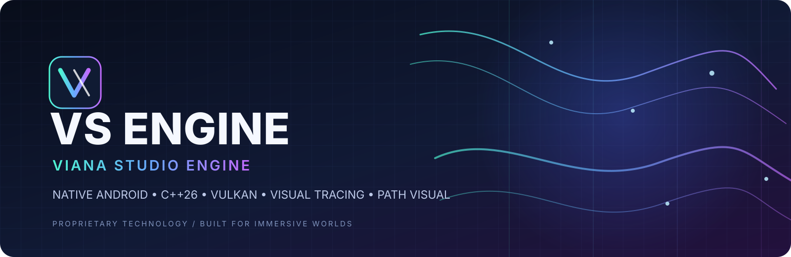
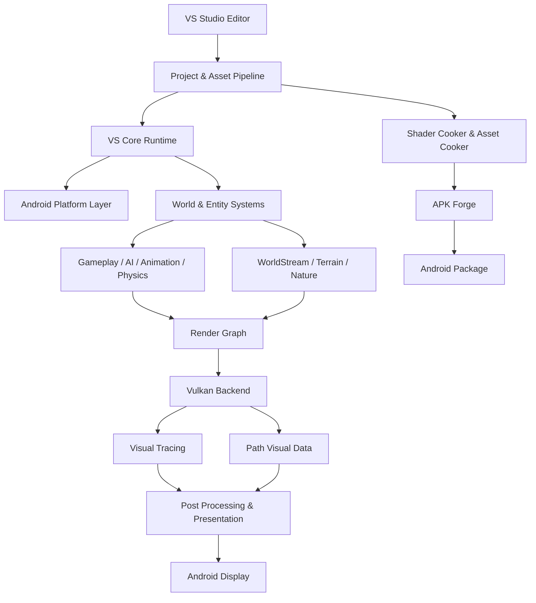
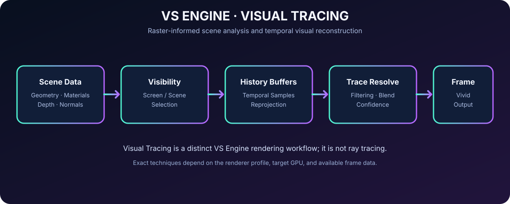
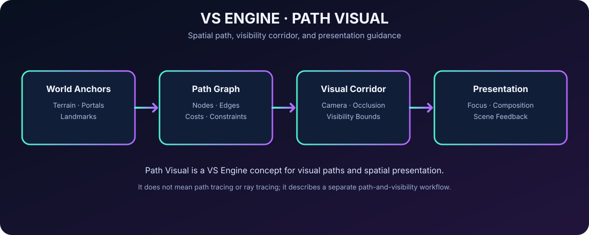
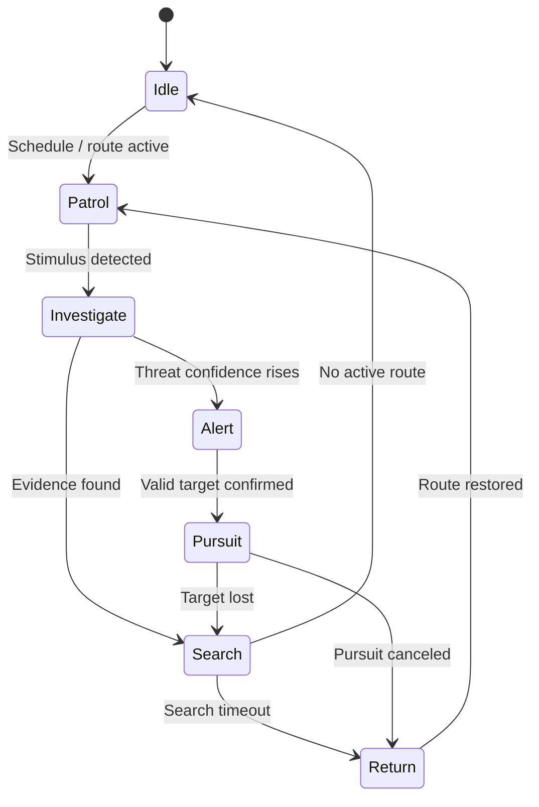

<p align="center">
  
</p>

<p align="center">
  
</p>

<h1 align="center">⚡ VS ENGINE — VIANA STUDIO ENGINE</h1>
<h3 align="center">Native Android Game Technology · Visual Tracing · Path Visual · Vulkan · C++26</h3>

<p align="center">
  <strong>Worlds are not just rendered. They are composed, traced visually, felt, and explored.</strong>
</p>

<p align="center">
  
  
  
  
  
  
</p>

<p align="center">
  
  
  
  
  
</p>

---

## 🪐 Welcome to VS Engine

**VS Engine (Viana Studio Engine)** is the proprietary native game-technology platform of **Viana Studio**, built around an Android-first runtime, modern Vulkan rendering, a modular C++26 architecture, high-fidelity world presentation, advanced animation, environmental simulation, and an integrated development ecosystem.

VS Engine brings its own identity to real-time graphics through two signature technology families: **Visual Tracing** and **Path Visual**. They are distinct from ray tracing and path tracing. Visual Tracing focuses on scene visibility, frame history, surface information, and visual reconstruction workflows. Path Visual focuses on spatial paths, world anchors, camera corridors, visibility guidance, and the way a scene is presented and navigated.

The engine's design language combines a high-end real-time renderer with tools for character creation, procedural worlds, physical interaction, visual scripting, AI-driven gameplay, cinematic sequencing, asset processing, diagnostics, and Android packaging. Its flagship showcase is **MDG: LOST FOREST**, featuring Hade and a living forest shaped by atmosphere, weather, exploration, and environmental storytelling.

> **VS Engine is an independent engine identity.** It is not Unreal Engine 5, a renamed Unreal Engine build, or a fork of Unreal Engine source code. Similar categories—rendering, physics, animation, terrain, or visual scripting—are common engine disciplines; VS Engine defines its own terminology, architecture, modules, and product identity.

## 🧭 Contents

- [✨ Identity](#-identity)
- [🧬 Technology DNA](#-technology-dna)
- [🧠 Architecture at a Glance](#-architecture-at-a-glance)
- [🎨 Visual Tracing](#-visual-tracing)
- [🧵 Path Visual](#-path-visual)
- [🖼️ Rendering and Graphics](#️-rendering-and-graphics)
- [🪨 Geometry and World Detail](#-geometry-and-world-detail)
- [🧑‍🚀 MetaHuman-Class Character Studio](#-metahuman-class-character-studio)
- [🦴 Animation and Motion](#-animation-and-motion)
- [💥 Physics and Destruction](#-physics-and-destruction)
- [🌌 VFX and Particles](#-vfx-and-particles)
- [🌲 World, Terrain, and Nature](#-world-terrain-and-nature)
- [🌧️ Weather, Water, and Atmosphere](#️-weather-water-and-atmosphere)
- [🤖 AI and NPC Intelligence](#-ai-and-npc-intelligence)
- [🔊 Audio](#-audio)
- [🧩 Visual Scripting](#-visual-scripting)
- [🧰 Editor and Content Pipeline](#-editor-and-content-pipeline)
- [📱 Android-First Runtime](#-android-first-runtime)
- [⚙️ Performance and Diagnostics](#️-performance-and-diagnostics)
- [🌐 Multiplayer and Persistence](#-multiplayer-and-persistence)
- [🌲 MDG: LOST FOREST](#-mdg-lost-forest)
- [🗂️ Repository Layout](#️-repository-layout)
- [🛡️ Proprietary Rights](#️-proprietary-rights)
- [📚 Terminology](#-terminology)
- [🖋️ Brand Statement](#️-brand-statement)

---

## ✨ Identity

| Field | Description |
|---|---|
| 🏷️ **Engine name** | VS Engine — Viana Studio Engine |
| 🏢 **Studio** | Viana Studio |
| 🎮 **Product class** | Native Android game engine and real-time creation technology |
| 🧱 **Core language** | Modern C++ with a C++26-oriented codebase |
| 🖥️ **Graphics foundation** | Vulkan-first rendering architecture |
| 📲 **Primary runtime** | Android phones and tablets |
| 🧰 **Build ecosystem** | Android NDK, CMake, Gradle, shader and asset cooking tools |
| 🎨 **Signature visual systems** | Visual Tracing and Path Visual |
| 🧬 **Character technology** | VS MetaHuman Studio and VS MotionForge |
| 🌎 **World technology** | VS WorldStream and VS Nature Systems |
| ⚡ **Rendering philosophy** | Capability-driven rendering, scalable visuals, adaptive quality |
| 🔒 **Distribution model** | Proprietary and closed-source |
| 🌲 **Flagship showcase** | MDG: LOST FOREST |

### 🪄 Engine Pillars

- **Visual Fidelity** — materials, lighting, geometry, atmosphere, animation, and post-processing work together as a unified scene.
- **Native Performance** — native execution, carefully managed resources, asynchronous asset work, and platform-aware scheduling.
- **Mobile-First Engineering** — quality profiles account for GPU capability, memory pressure, display characteristics, and thermal conditions.
- **World Presence** — terrain, foliage, weather, water, sound, creatures, and lighting respond to shared world events.
- **Creative Control** — scene editing, material graphs, animation graphs, particle authoring, visual scripts, and cinematic tools share a consistent workflow.
- **Production Discipline** — profiling, validation, resource inspection, build diagnostics, reproducible packaging, and explicit error reporting are part of the engine identity.
- **Independent Technology** — VS Engine has its own modules, naming, APIs, documentation, and proprietary distribution terms.

## 🧬 Technology DNA

<p align="center">
  
  
  
  
  
  
</p>

### 🧱 Core Technology Families

| Family | What it represents |
|---|---|
| ⚙️ **VS Core** | Runtime lifecycle, object model, events, modules, reflection, resource ownership, serialization, diagnostics |
| 🪟 **VS Platform** | Android lifecycle, native windows, input, display, filesystem, permissions, and platform services |
| 🎛️ **VS RenderCore** | Render graph, GPU resource management, frame orchestration, pipeline state, and renderer backends |
| 💎 **VS VividTrace** | Visual Tracing workflows, temporal visual reconstruction, scene visibility, surface history, and vibrant presentation |
| 🧭 **VS Path Visual** | Spatial path graphs, camera corridors, visibility routes, world anchors, and visual navigation data |
| 🪨 **VS NanoForge** | Mesh processing, clustering, geometry LOD, visibility, compression, and streaming |
| 🧑‍🚀 **VS MetaHuman Studio** | Human-character assembly, facial systems, skin materials, hair, rigging, and character authoring |
| 🦴 **VS MotionForge** | Animation graphs, retargeting, IK, motion matching, pose blending, and procedural movement |
| 💥 **VS ChaosCore** | Collision, rigid bodies, constraints, vehicle dynamics, cloth, soft bodies, and breakable objects |
| 🌌 **VS NiagaraFX** | Particle graphs, GPU particles, ribbons, trails, environmental effects, and simulation events |
| 🌍 **VS WorldStream** | World cells, terrain streaming, region transitions, persistent world data, and distance-based detail |
| 🌲 **VS Nature** | Trees, grass, foliage, wind, surface interaction, vegetation LOD, and biome-aware distribution |
| 🤖 **VS Neural AI** | Perception, state trees, behavior graphs, navigation, utility decisions, and gameplay cognition |
| 🔊 **VS Audio** | Spatial audio, buses, reverb, occlusion, ambient worlds, dialogue, and event synchronization |
| 🧩 **VS Blueprint Flow** | Node-based logic, reusable graphs, typed pins, variables, debugging, and gameplay event wiring |
| 🧰 **VS Studio Tools** | Editor, asset processing, shader compilation, project management, profiling, and APK packaging |

## 🧠 Architecture at a Glance



### 🧩 Runtime Layering

1. **Platform layer** — native windowing, application lifecycle, device capabilities, input, display events, and Android integration.
2. **Core layer** — types, memory systems, jobs, events, object lifetime, serialization, resource references, and module discovery.
3. **World layer** — scenes, actors, components, transforms, spatial indexes, world partitioning, and persistent state.
4. **Simulation layer** — animation, physics, AI, gameplay events, navigation, environment systems, and audio events.
5. **Presentation layer** — Vulkan rendering, materials, geometry, post-processing, Visual Tracing, Path Visual, particles, and UI.
6. **Creation layer** — editor panels, importers, asset metadata, graph editors, build profiles, and inspection tools.
7. **Delivery layer** — asset cooking, shader variants, native linking, APK packaging, deployment, and diagnostics.

### 🔁 Shared Data Contracts

The engine uses consistent contracts for entity identity, transform data, resource handles, frame state, world coordinates, material parameters, animation events, collision events, AI perception results, and persistent identifiers. Cross-system integration is defined through stable module interfaces rather than hidden hard-coded dependencies.

## 🎨 Visual Tracing

<p align="center"></p>

**Visual Tracing** is the VS Engine visual-analysis and reconstruction family. It works with scene information already available to the rendering pipeline—such as depth, surface normals, material parameters, visibility data, screen-space information, temporal history, and selected spatial structures—to guide visual effects and frame reconstruction.

**Visual Tracing is not ray tracing.** VS Engine's signature visual identity does not depend on requiring a ray-tracing-capable GPU. Its renderer can use rasterization, scene buffers, temporal processing, probes, cached lighting information, signed-distance representations, and screen-space techniques as appropriate to the selected profile.

### 🧬 Visual Tracing Modules

| Module | Responsibility |
|---|---|
| 🧿 **VTrace Scene Analyzer** | Collects relevant scene-visible data for visual processing. |
| 🧱 **VTrace Surface Inspector** | Interprets depth, normals, material classes, and surface response. |
| 👁️ **VTrace Visibility Map** | Tracks visible regions and contributes visibility information to compatible effects. |
| 🕰️ **VTrace Temporal History** | Maintains frame history for temporal reconstruction and stability. |
| 🧭 **VTrace Motion Reprojection** | Uses motion information to align eligible prior-frame samples. |
| 🌫️ **VTrace Atmosphere Resolver** | Integrates supported fog, atmosphere, and volumetric presentation data. |
| 🌿 **VTrace Nature Response** | Coordinates foliage and environmental presentation parameters. |
| 💧 **VTrace Wet Surface** | Drives wetness-related material response and reflections through supported effects. |
| 💡 **VTrace Lighting Resolver** | Combines compatible lighting sources, probes, shadowing, and indirect-light approximations. |
| 🧹 **VTrace Noise & Stability Filter** | Applies configurable filtering and temporal stability controls to supported effects. |
| 🎞️ **VTrace Frame Composer** | Combines compatible visual results before final color grading and tone mapping. |
| 📈 **VTrace Quality Governor** | Adjusts sample counts, resolution, and effect cost based on device profile. |

### ✨ Visual Tracing Capabilities

- Depth-informed visual analysis.
- Surface-normal and material-aware effects.
- Temporal history and reprojection workflows.
- Visibility-guided rendering decisions.
- Screen-space reflection and occlusion options.
- Probe-driven indirect-light contribution.
- Shadow-map integration and contact-shadow approximations.
- Atmospheric and wet-surface presentation.
- Vibrant color response and filmic tonemapping.
- Stability controls for motion and camera changes.
- Scalable effect quality across Android GPU classes.
- Fallback behavior when a preferred effect is unavailable.

### 🎨 Vivid Visual Identity

VividTrace profiles can combine saturated forest greens, controlled cyan shadows, warm sunlight, soft highlights, rich material response, and cinematic atmospheric depth. Color grading is configurable and never substitutes for correct color-space handling, physically based materials, or exposure management.

## 🧵 Path Visual

<p align="center"></p>

**Path Visual** is VS Engine's spatial path and visual-presentation system. It organizes path graphs, world anchors, scene visibility corridors, camera intent, routes through complex environments, and the relationship between navigable spaces and what a player can see.

**Path Visual is not path tracing and is not ray tracing.** The word *path* here refers to spatial paths and visual routes through a world, not a light transport algorithm based on tracing rays through pixels.

### 🧭 Path Visual Modules

- 🗺️ **PV World Anchors** — landmarks, terrain anchors, entrances, portals, event locations, and authored points of interest.
- 🕸️ **PV Path Graph** — nodes, directed or undirected edges, traversal costs, tags, constraints, and graph connectivity.
- 🚪 **PV Portal Links** — transitions between rooms, caves, buildings, world cells, and other spatial regions.
- 👁️ **PV Visibility Corridor** — spatial bounds and view-guidance data for visibility-aware traversal and presentation.
- 🎥 **PV Camera Intent** — camera targets, focus zones, authored viewpoints, and transition hints.
- 🎯 **PV Focus Field** — player-facing presentation cues for objectives, landmarks, and interactive spaces.
- 🧱 **PV Occlusion Context** — links path segments to compatible occlusion and visibility data.
- 🧭 **PV Route Context** — route annotations for AI navigation, world streaming, or guided exploration.
- 🌄 **PV Horizon Control** — scene composition data for landmarks, silhouettes, and distant vistas.
- 🎬 **PV Cinematic Paths** — camera rails, spline-guided movement, and authored sequence paths.
- 🧪 **PV Debug View** — visualizes nodes, edges, anchors, camera corridors, and route costs.
- 📦 **PV Streaming Hints** — associates path-adjacent regions with prefetch and streaming priority hints.

### 🧶 Path Visual Use Cases

- Directing the player's view toward significant environments without forcing camera control.
- Connecting a winding forest trail to the world-streaming system.
- Previewing cinematic camera movement along a spline.
- Improving the presentation of caves, corridors, ruins, and multi-level structures.
- Visualizing traversal links and transition points in the editor.
- Communicating route context to AI navigation and gameplay systems.
- Prioritizing nearby assets along a player route where appropriate.
- Creating authorable visual corridors through complex scene layouts.

## 🖼️ Rendering and Graphics

### 🎛️ VS RenderCore

VS RenderCore coordinates frame construction, render passes, shader variants, GPU resources, render dependencies, visibility work, and final presentation. Its Vulkan backend is built around explicit resource ownership and feature detection.

**Graphics features in the VS rendering family:**

- 🟣 Vulkan rendering backend and capability discovery.
- 🧱 Forward and deferred rendering paths where applicable.
- 💡 Clustered or tiled light assignment.
- 🪞 Physically based material rendering.
- 🌈 Linear-light processing and HDR-capable pipelines.
- 🎞️ Tone mapping, exposure control, and color grading.
- 🌑 Shadow maps, cascaded shadows, and contact-shadow effects.
- 🌫️ Fog, height fog, atmospheric perspective, and selected volumetric effects.
- ✨ Bloom, depth of field, motion blur, and vignette as configurable effects.
- 🧿 Screen-space ambient occlusion and reflections where appropriate.
- 🌿 Instanced foliage and vegetation rendering.
- 🪨 Mesh LOD, meshlets, batching, and visibility culling.
- ⚡ GPU-driven paths where supported by the target hardware.
- 🧊 Texture compression, mipmaps, and texture streaming.
- 🧵 Asynchronous upload and background resource preparation.
- 📉 Dynamic resolution and profile-based quality control.
- 🧪 Debug visualization for normals, depth, roughness, overdraw, and lighting.

### 🌈 Color, HDR, and Exposure

The presentation pipeline supports linear-space shading, configurable exposure, tone-mapping operators, white balance, color grading, saturation controls, highlight roll-off, shadow shaping, and display-aware output settings. HDR output depends on the display, Android version, swapchain configuration, and device support.

### 🌑 Shadows and Occlusion

The engine combines depth-aware visibility, shadow-map techniques, cascade selection, receiver bias controls, contact-shadow options, ambient occlusion, and scene-specific fallback settings. Shadow quality can be lowered independently from texture and geometry quality to retain responsive frame pacing on mobile hardware.

### 🧊 Materials and Surface Response

- Base color, metallic, roughness, normal, ambient occlusion, and emission.
- Clear-coat-like response and anisotropic response where suitable.
- Alpha masking and transparent materials.
- Layered material definitions and reusable instances.
- Surface decals and detail textures.
- Wetness, mud, moss, snow, dust, and weather-driven material parameters.
- Triplanar and world-space material coordinate options.
- Texture streaming, mip selection, and device-aware texture formats.
- Shader variant management and pipeline cache integration.

### 🚫 No Ray-Tracing Dependency

VS Engine's headline rendering identity is **Visual Tracing + Path Visual**, not ray tracing. No central feature description requires a ray-tracing-capable GPU. The graphics stack centers on Vulkan rasterization, scene data, visual histories, spatial path structures, temporal techniques, probes, and configurable screen-space effects. Optional platform experiments must not be confused with the core rendering model.

## 🪨 Geometry and World Detail

### 💎 VS NanoForge

NanoForge organizes dense geometry through asset processing, cluster building, mesh simplification, meshlet generation, visibility selection, compression, and level-of-detail strategies.

- 🧊 Mesh import and geometry validation.
- 🔺 Triangle and index optimization.
- 🧩 Meshlet and cluster construction.
- 🪜 Hierarchical level of detail.
- 👁️ Frustum and occlusion culling.
- 📦 Compressed geometry storage.
- 🌍 Distance-based detail selection.
- 🌊 Asynchronous geometry streaming.
- 🪴 Instanced vegetation geometry.
- 🧰 Collision proxy generation.
- 🔍 Geometry debug views and statistics.
- 📉 Memory-aware residency management.

### 🗻 Landscape and Terrain

VS Landscape Studio supports heightfield terrain, terrain materials, sculpting data, painting layers, terrain LOD, landscape collision, procedural placement data, and world-cell integration.

- Mountain and cliff composition.
- Valleys, ridges, paths, and clearings.
- Terrain texture blending.
- Surface-type queries for audio and movement.
- Grass and foliage density masks.
- River and lake integration.
- Terrain collision generation.
- Distance-based terrain streaming.
- Terrain splines and authored roads.
- Terrain visualization and performance overlays.

### 📐 Geometry Integrity

Geometry processing follows consistent coordinate, tangent, normal, UV, skeleton, and material conventions. Import diagnostics identify missing attributes, degenerate geometry, invalid references, unsupported material inputs, and incompatible resource settings before runtime packaging.

## 🧑‍🚀 MetaHuman-Class Character Studio

### 👤 VS MetaHuman Studio

VS MetaHuman Studio is the VS Engine character-technology family for assembling expressive digital humans and other high-detail characters. It unifies skeletal structure, facial systems, hair, skin materials, clothing, retargeting, and character quality profiles.

- 🧬 Character anatomy and proportion controls.
- 🙂 Facial topology and deformation data.
- 👁️ Eye, iris, and corneal-material workflows.
- 🧴 Layered skin materials and microdetail.
- 💇 Hair, eyebrows, eyelashes, and beard pipelines.
- 🦷 Teeth, tongue, jaw, and mouth rigs.
- 🦴 Skeletal rigs and bone hierarchy management.
- 🎭 Facial pose libraries and expression blending.
- 🗣️ Phoneme-driven lip-sync integration.
- 🎯 Eye gaze and blink controls.
- 🧥 Clothing materials and garment simulation hooks.
- 🔁 Animation retargeting and skeleton mapping.
- 📉 Character LOD and deformation-cost controls.
- 💾 Character presets and reusable character assets.

### 🎭 Facial Expression Framework

Facial expression data is organized into pose targets, blend shapes, animation curves, corrective shapes, eye direction, jaw control, and expression layers. Character dialogue, emotion-state logic, and cinematic events can drive compatible expression controls without coupling the renderer to a single character.

### 💇 Hair, Skin, and Clothing

The material family supports skin roughness variation, subsurface-style response where available, layered skin detail, anisotropic hair shading options, hair cards, strand-like groom interchange workflows, eye materials, fabric shading, cloth secondary motion, and profile-specific simplification.

### 📱 Character Profiles

| Profile | Typical use |
|---|---|
| 🎬 **Cinematic** | High-detail hero characters and controlled scenes |
| 💎 **Ultra** | High-end mobile devices with sufficient thermal headroom |
| 🌟 **High** | Detailed characters with moderated effects |
| ⚖️ **Balanced** | General gameplay and longer sessions |
| 🍃 **Mobile** | Reduced strand count, deformation cost, and material complexity |
| 🔋 **Efficiency** | Lower-cost rendering for temperature and battery limits |

## 🦴 Animation and Motion

### 🌀 VS MotionForge

- 🎞️ Skeletal animation and clip playback.
- 🧩 Animation graphs and state machines.
- 🌳 Blend trees and blend spaces.
- 🎭 Pose blending and animation layers.
- 🦿 Inverse kinematics and forward kinematics.
- 🦶 Foot placement and foot locking.
- ✋ Hand IK and look-at constraints.
- 🧍 Full-body pose solving hooks.
- 🏃 Root motion and motion warping.
- 🔁 Retargeting between compatible skeletons.
- 🧠 Motion matching and pose search architecture.
- 🪄 Procedural animation and secondary motion.
- 💥 Physics-driven animation and ragdoll transitions.
- 🔔 Animation events and gameplay notifies.
- 🗜️ Animation compression and streaming.
- 🧬 Facial animation curves and lip-sync tracks.

### 🚶 Locomotion

Movement animation handles idle, walking, jogging, running, sprinting, crouching, crawling, jumping, landing, falling, climbing, vaulting, swimming, slope traversal, turn-in-place, and context-sensitive transitions. Movement state, footstep surfaces, camera response, audio, and gameplay events use a common character-state interface.

### 🎬 Cinematic Motion

Timeline-driven sequences support camera tracks, transform tracks, animation clips, facial curves, dialogue, subtitle timing, audio cues, lighting events, and scripted triggers. Sequences can blend in and out of gameplay camera states and preserve defined save-safe transitions.

## 💥 Physics and Destruction

### 🧲 VS ChaosCore

ChaosCore groups collision queries, rigid-body behavior, constraints, simulation stepping, physical materials, vehicles, ropes, cloth, soft bodies, and breakable-object events behind a consistent physics interface.

- ⚪ Sphere, capsule, box, plane, and convex colliders.
- 🧱 Static and dynamic rigid bodies.
- 🔩 Hinge, distance, spring, and fixed constraints.
- 🚗 Vehicle suspension and wheel interaction.
- 🧍 Character-controller collision.
- 🎯 Raycast-style queries as physics queries, not a rendering technology.
- 🧵 Rope and cloth simulation interfaces.
- 🫧 Soft-body simulation interfaces.
- 🦴 Ragdoll and physical-animation integration.
- 💢 Impact events and breakable props.
- 🪨 Fracture groups and debris controls.
- 🧪 Physics debug drawing and contact inspection.
- ⏱️ Fixed-step simulation and substepping.
- 💤 Sleeping bodies and collision filtering.

### 🧱 Destruction Systems

VS Destruction organizes breakable objects, fracture definitions, damage thresholds, impact-driven events, debris lifetime, simplified collision after destruction, and LOD controls. Destruction content is configurable so a dramatic set-piece does not force the same simulation cost on every mobile device.

## 🌌 VFX and Particles

### ✨ VS NiagaraFX

- 🔥 Fire and ember effects.
- 🌫️ Smoke, fog wisps, dust, and mist.
- 🌧️ Rain, droplets, splashes, and runoff.
- ❄️ Snow and drifting particles.
- ⚡ Lightning and spark effects.
- 🍃 Leaves, pollen, spores, and environmental debris.
- 💧 Water splashes and waterfall spray.
- 🪄 Magical effects and energy trails.
- 💥 Impact bursts and explosion effects.
- 🧵 Ribbons, trails, and curved particle paths.
- 🎞️ Flipbook and sprite-sheet animation.
- 🧲 Attractors, forces, and vector-field inputs.
- 🧊 Collision with supported scene representations.
- 🧮 Compute-driven particle simulation where appropriate.
- 📉 Particle pooling, LOD, and quality budgets.

### 🎛️ Particle Graphs

The particle authoring model combines emitters, spawn rules, update modules, parameter maps, event outputs, render settings, and reusable effect presets. Effects can react to gameplay events, animation notifies, world weather, collision impacts, and region transitions.

## 🌲 World, Terrain, and Nature

### 🌎 VS WorldStream

WorldStream manages large scenes as spatial regions with defined ownership, metadata, load priorities, visibility state, dependencies, and persistent world events.

- 🧭 World cells and region descriptors.
- 📦 Asynchronous level and asset loading.
- 🗺️ Terrain and environment streaming.
- 👁️ Visibility-aware scene activation.
- 💾 Persistent objects and world state.
- 🚪 Portal transitions and cave/indoor links.
- 🌄 Distance-dependent LOD and impostors.
- 📥 Predictive prefetch hints from player movement.
- 🧠 Memory-budgeted residency policies.
- 🧰 Region-level debugging and dependency inspection.

### 🌳 VS Nature System

Nature unifies procedural vegetation placement, foliage assets, wind response, density masks, biome rules, interactive plant behavior, and scene streaming.

- 🌲 Tree and trunk generation workflows.
- 🌿 Grass, fern, bush, flower, and ground-cover placement.
- 🍂 Leaf clusters and falling-leaf effects.
- 🌬️ Wind-driven leaf and branch motion.
- 👣 Movement-reactive foliage.
- 🌧️ Wet foliage material response.
- 🪴 Biome-dependent asset selection.
- 📏 Vegetation LOD, instancing, and culling.
- 🪵 Bark, moss, root, rock, and soil material families.
- 🧱 Foliage collision and simplified interaction proxies.
- 🌱 Density painting and procedural scatter controls.

### 🪵 Environmental Detail

The environment asset library is organized around material families and interaction categories: bark, deadwood, moss, ferns, roots, stones, mud, leaf litter, wet soil, water edges, ruined masonry, old timber, overgrown structures, and abandoned human-made objects. Surface identifiers can feed movement sounds, particles, footprints, and other gameplay responses.

## 🌧️ Weather, Water, and Atmosphere

### ☁️ VS Atmosphere

- 🌤️ Sky rendering and sun/moon direction.
- 🌫️ Height fog and distance fog.
- 🌁 Selected volumetric fog effects.
- ☁️ Cloud layers and cloud-shadow approximations.
- 🌅 Sunrise, daylight, golden hour, dusk, and night profiles.
- 🌌 Star-field presentation.
- 🌬️ Wind direction and intensity.
- 🌧️ Rain intensity and local storm zones.
- ⚡ Lightning flashes and weather events.
- ❄️ Snow effects and surface coverage parameters.
- 🌄 Atmospheric perspective and horizon controls.

### 💧 VS Water

- 🌊 Water surface mesh and material.
- 〰️ Wave animation and normal movement.
- 🪞 Reflection and refraction options.
- 🫧 Foam and shoreline response.
- 💦 Waterfall and river-flow presentation.
- 🌫️ Water mist and splash effects.
- 🌑 Underwater fog and color absorption.
- 🧭 Surface flow vectors.
- 👣 Character-water interaction events.
- 📉 Quality-scaled water rendering and simulation.

### 🌦️ Environmental State Coupling

Weather, audio, materials, foliage, particles, lighting, AI perception, and player movement can share a common environment state. Rain may change surface response and audio; wind may influence foliage and ambience; fog may alter scene visibility; time of day may adjust wildlife routines and environmental presentation.

## 🤖 AI and NPC Intelligence

### 🧠 VS Neural AI

VS Neural AI is a gameplay-AI framework—not a requirement that every NPC run a large language model. It combines authored behavior, state machines, perception, navigation, memory records, utility scoring, and optional local inference integrations.

- 👁️ Vision and field-of-view sensors.
- 👂 Hearing and stimulus events.
- 🧠 Blackboard-style state data.
- 🌳 Behavior trees and state trees.
- 🎯 Utility scoring and goal selection.
- 🗺️ Navigation meshes and path following.
- 🧍 Crowd avoidance and local steering.
- 🔍 Search and investigation behavior.
- 🚶 Patrol and schedule-based behavior.
- 🧭 Last-known-position tracking.
- 🧩 Environmental query hooks.
- 💬 Dialogue state and conversation triggers.
- 💾 Persistent NPC state.
- 🪫 AI workload budgets and update staggering.
- 🔌 Optional local model inference through a separate integration layer.

### 👣 Example NPC State Flow



### 🧑‍🤝‍🧑 Character Behavior

NPC logic can incorporate route state, visibility, hearing events, environmental conditions, animation availability, distance to the player, world-cell activity, and performance budgets. High-cost decisions may be updated less frequently at a distance while nearby characters retain more detailed behavior.

## 🔊 Audio

### 🎧 VS Audio

- 🎚️ Audio mixer and bus hierarchy.
- 📍 Positional audio and distance attenuation.
- 🚪 Occlusion and obstruction controls.
- 🏞️ Environment reverb zones.
- 🌲 Region-specific ambience layers.
- 👣 Surface-dependent footsteps.
- 🌧️ Weather-reactive environmental audio.
- 🗣️ Dialogue and subtitle-event synchronization.
- 🎼 Adaptive music state transitions.
- 🫁 Character movement and breathing states.
- 💦 Water, cave, and indoor acoustic presets.
- 🧵 Audio streaming and resource caching.
- 🎛️ Volume, dynamic range, and accessibility settings.

### 🔉 Soundscape Design

The soundscape supports near, mid, and distant layers. Each layer can respond to the player's region, visibility context, weather, time of day, and nearby gameplay events. Environmental audio uses authorable attenuation, bus routing, reverb, and cross-fades rather than requiring every scene to use the same mix.

## 🧩 Visual Scripting

### 🔌 VS Blueprint Flow

Blueprint Flow offers a node-based interface for wiring gameplay events and data without requiring each behavior to be written as a new C++ class.

- 🔷 Event nodes and execution pins.
- 🟪 Typed data pins.
- 🟩 Variables, getters, and setters.
- 🔀 Branches and conditional logic.
- 🔁 Loops and iteration nodes.
- ⏱️ Timers and delayed events.
- 🧮 Vector, rotation, transform, and math operations.
- 🧱 Entity/component queries.
- 💥 Collision and physics events.
- 🦴 Animation controls and notifies.
- 🌌 VFX spawn and parameter updates.
- 🔊 Audio playback and mixing events.
- 🤖 AI state commands.
- 📦 Inventory, quest, and save-system calls.
- 🖥️ UI interaction events.
- 🧪 Watch values, graph stepping, and execution tracing.
- 📚 Reusable functions, macros, and subgraphs.

### 🧵 Graph Design Principles

The graph system uses explicit data types, validation for missing connections, understandable execution flow, reusable functions, readable naming, graph-level diagnostics, and an inspectable serialization format. Native systems expose selected APIs to graph nodes through documented bindings.

## 🧰 Editor and Content Pipeline

### 🖥️ VS Studio Editor

The editor shell unifies scene editing, asset browsing, property inspection, world navigation, material creation, animation review, VFX setup, visual scripting, debugging, and Android deployment controls.

| Panel | Icon | Role |
|---|---:|---|
| Scene Viewport | 🖼️ | Inspect and compose the 3D world |
| World Outliner | 🌳 | Browse entities and hierarchy |
| Inspector | 🔎 | Edit component and asset properties |
| Content Browser | 🗂️ | Organize and preview project assets |
| Material Studio | 🎨 | Edit surface parameters and shader graphs |
| Animation Studio | 🦴 | Review skeletons, clips, poses, and retargeting |
| VFX Studio | ✨ | Author particle systems and effects |
| Terrain Studio | 🗻 | Sculpt, paint, and manage terrain data |
| Blueprint Flow | 🧩 | Connect gameplay events and logic |
| Audio Studio | 🎧 | Inspect sources, buses, and sound events |
| AI Debugger | 🤖 | Inspect states, paths, and perception |
| Physics Debugger | 🧲 | Inspect colliders, contacts, and simulation |
| Performance Monitor | 📊 | Review CPU, GPU, memory, and frame metrics |
| Build Center | 📦 | Configure native Android packaging |

### 📦 Asset Pipeline

The asset pipeline handles file discovery, import settings, conversion, validation, dependency tracking, derived-data caching, compression, and runtime package generation.

**Asset families:**

- 🧊 Meshes and scene interchange files.
- 🧍 Skeletal meshes, skeletons, and animation clips.
- 🖼️ Textures, texture arrays, and compressed texture formats.
- 🎨 Materials, parameters, and shader graphs.
- 🎧 Audio files and event metadata.
- ✨ Particle definitions and effect presets.
- 🗻 Terrain data and landscape layers.
- 📜 Gameplay data, curves, localization, and quest definitions.
- 🎬 Cinematic tracks and camera paths.
- 🧩 Blueprint graphs and reusable logic assets.

### 🔧 Shader and Asset Cooking

The cooking pipeline selects platform-compatible data, compiles shader variants, preprocesses meshes, prepares textures, validates dependencies, packages runtime resources, and records build metadata. Derived assets are kept separate from authoring assets so a packaged Android game does not need the complete editor toolchain.

### 🧱 Import Diagnostics

- Missing textures and material references.
- Unsupported or malformed mesh attributes.
- Missing skeleton references.
- Invalid animation mappings.
- Texture dimensions and memory warnings.
- Duplicate asset identifiers.
- Cyclic or missing dependencies.
- Unsupported shader features for a selected profile.
- Asset path and case-sensitivity warnings.
- Packaging inclusion and exclusion checks.

## 📱 Android-First Runtime

### 📲 Native Platform Layer

VS Engine is organized around native Android execution rather than treating a browser or a desktop runtime as the center of the game. Its platform layer covers application lifecycle events, native windows, touch input, display changes, filesystem access, native audio, permissions, and device capability queries.

- 📱 Android Native Activity integration.
- 🧰 Android NDK and native shared libraries.
- 🧱 CMake-based C++ project configuration.
- 📦 Gradle-based Android packaging.
- 🎮 Touch and multi-touch input.
- 🖥️ External display and refresh-rate information where available.
- 🎧 Android audio output integration.
- 🧭 Orientation and viewport updates.
- 💤 Pause, resume, background, and foreground handling.
- 🔋 Battery and thermal-state-aware quality controls.
- 🎮 Controller input where the device exposes it.
- 📁 Packaged asset access and app-private data storage.

### 🧬 Graphics Compatibility

The renderer selects supported Vulkan capabilities at runtime and maintains clear fallback paths for features that are not available on a device. OpenGL ES may be provided as a compatibility backend for selected configurations. Optional features are enabled only when both the GPU and driver expose the required capabilities.

### 📦 Native Delivery

The Android delivery pipeline combines the native runtime, compiled shaders, cooked assets, manifest settings, signing configuration, application resources, and supported ABI binaries into a package. Build tools report missing dependencies, unsupported configurations, and packaging errors instead of silently omitting required content.

## ⚙️ Performance and Diagnostics

### 📊 VS Performance Suite

- ⏱️ CPU frame-time tracking.
- 🎮 GPU frame-time tracking where available.
- 🧵 Thread and job workload visualization.
- 🧠 Memory allocation and residency inspection.
- 🧊 Texture and geometry memory budgets.
- 🪨 Draw-call, batch, and triangle counters.
- 🌌 Render-pass timing and GPU timestamp support.
- 📦 Asset streaming and decompression timing.
- 🦴 Animation and character update costs.
- 💥 Physics-step cost tracking.
- 🤖 AI update workload inspection.
- ✨ Particle simulation and rendering metrics.
- 🌡️ Thermal-aware profile reporting where available.
- 🧪 Vulkan validation and GPU-resource diagnostics.
- 📉 Frame pacing and dynamic-resolution telemetry.
- 🧾 Crash logs, error categories, and build records.

### 🎛️ Quality Profiles

| Profile | Rendering personality | Common use |
|---|---|---|
| 🎬 **Cinematic** | Highest eligible effects, detailed shadows, richer atmosphere | Controlled scenes and capable devices |
| 💎 **Ultra** | High detail and presentation quality | High-performance mobile devices |
| 🌟 **High** | Detailed materials and effects with managed cost | Balanced high-quality play |
| ⚖️ **Balanced** | Moderate shadows, effects, and geometry cost | Broad device coverage |
| 🍃 **Mobile** | Reduced high-cost effects and detail density | Longer gameplay sessions |
| 🔋 **Efficiency** | Lower workload and restrained effect budgets | Battery- and temperature-conscious play |
| 🧪 **Custom** | Per-system configuration | Advanced tuning and testing |

### 🧯 Failure Handling

The runtime treats device loss, allocation failures, shader errors, invalid resources, missing assets, lifecycle interruptions, and unsupported optional features as explicit conditions. Diagnostics include context, resource identifiers where available, and actionable information for investigation.

### 🧪 Validation Culture

A successful compilation is not interchangeable with a successful runtime test. The validation workflow separates source compilation, shader compilation, asset cooking, package assembly, installation, startup, rendering, input, lifecycle transitions, save/load behavior, and sustained performance checks.

## 🌐 Multiplayer and Persistence

### 🔗 VS Network Layer

- 🧑‍🤝‍🧑 Session and lobby abstraction.
- 🪪 Network identity and entity replication.
- 📡 Reliable and unreliable message channels.
- 🔄 State snapshots and interpolation.
- 🎯 Input prediction and reconciliation interfaces.
- 🧭 Server-authoritative simulation patterns.
- 📉 Bandwidth measurement and prioritization.
- 🔐 Secure transport integration points.
- 🔁 Reconnection and session recovery.
- 🧪 Network diagnostics and packet inspection tools.

### 💾 VS Save System

- 🗃️ Multiple save slots.
- 🧭 Checkpoints and progression markers.
- 🎒 Inventory and equipment persistence.
- 📜 Quest state and story flags.
- 🌎 World-event and discovered-location records.
- ⚙️ User settings and control mappings.
- 🧩 Versioned serialization and migration hooks.
- 🗜️ Optional save compression.
- ✅ Data validation and recovery support.
- 🔄 Autosave policies for supported gameplay states.

## 🌲 MDG: LOST FOREST

<p align="center">
  
  
  
  
</p>

**MDG: LOST FOREST** is the flagship game world associated with VS Engine: an atmospheric first-person exploration and survival experience where forest ecology, ancient structures, weather, sound, light, and world discovery form one continuous environment.

### 🌲 World Regions

1. **The Emerald Threshold** — the first passage into the deep forest.
2. **Whispering Pines** — dense conifers, winding tracks, and distant calls.
3. **The Sunken Grove** — low ground, reflective water, and old roots.
4. **Blackroot Valley** — dark vegetation, ravines, and narrow crossings.
5. **The Forgotten Village** — abandoned structures consumed by nature.
6. **Hollowstone Mountains** — cliffs, caves, and elevated trails.
7. **The Ancient Canopy** — layered treetops and filtered sunlight.
8. **The Mistbound River** — water routes, waterfalls, and foggy banks.
9. **The Silent Marsh** — unstable terrain, reeds, and obscured sightlines.
10. **The Buried Sanctuary** — an ancient site hidden below the forest.
11. **The Ashen Clearing** — a scarred landscape with a different material palette.
12. **The Lost Observatory** — a landmark that connects the forest's story threads.
13. **The Deep Forest** — remote terrain with limited familiar paths.
14. **The Heart of Lost Forest** — the central narrative location.

### 🧑 Hade — Central Character

Hade is the central character used to showcase VS MetaHuman Studio, MotionForge, character interaction, first-person animation, environmental audio, and contextual gameplay events.

- Detailed skeletal character foundation.
- Facial expression and gaze controls.
- Contextual movement and interaction animations.
- Surface-aware footsteps.
- Flashlight and exploration-equipment interaction.
- Journal, map, inventory, and collectible integration.
- Animation events connected to audio and gameplay.
- Character status and persistent progress.
- Cinematic camera and narrative-event integration.

### 🍃 World Simulation

- Tree canopies and layered foliage.
- Grass, ferns, bushes, moss, exposed roots, and deadwood.
- Wet stone, soil, mud, and puddles.
- Rivers, streams, waterfalls, and mist.
- Time-of-day lighting variations.
- Rainstorms, wind, fog, and environmental particles.
- Region-specific ambience and wildlife.
- Abandoned buildings, ruins, caves, and hidden paths.
- Environmental puzzles and discoverable lore.
- World-cell streaming and distance-dependent detail.

### 🌈 MDG Vivid Visual Presets

- 🌅 **Emerald Morning** — clear green foliage with soft directional sunlight.
- ☀️ **Canopy Gold** — warm shafts of light, richer leaf translucency, and golden highlights.
- 🌫️ **Mistbound** — layered fog, reduced distant contrast, and cool forest ambience.
- 🌧️ **Rain Memory** — wet materials, puddles, runoff, and rain-driven sound layers.
- 🌌 **Moonlit Grove** — restrained moonlight, cool shadows, and atmospheric silhouettes.
- ⚡ **Storm Signal** — dynamic sky contrast, lightning events, and wind response.
- 🪨 **Ancient Stone** — damp masonry, moss, roughness variation, and low-angle lighting.
- 🌿 **Living Canopy** — dense foliage, moving leaves, and filtered environmental light.

### 🎮 Gameplay Systems

- First-person exploration and camera control.
- Contextual world interaction.
- Object inspection and collection.
- Inventory and equipment management.
- Flashlight and resource management.
- Environmental puzzles.
- Notes, documents, journals, and narrative discoveries.
- Checkpoints and save persistence.
- Wildlife and NPC behavior.
- Weather-linked sound and material response.
- Quest flags and branching narrative events.
- Optional accessibility and motion-comfort settings.

### 📱 Mobile Gameplay Presentation

MDG: LOST FOREST uses a customizable touchscreen HUD, virtual movement controls, camera-look input, interaction prompts, inventory access, a journal interface, graphics presets, sensitivity settings, safe-area-aware layout, and optional supported controller input.

## 🗂️ Repository Layout

```text
VS-Engine/
├── README.md
├── LICENSE-PROPRIETARY.md
├── NOTICE.md
├── assets/
│   ├── vs-engine-banner.svg
│   ├── vs-engine-logo.svg
│   ├── visual-tracing.svg
│   └── path-visual.svg
├── .github/
│   ├── ISSUE_TEMPLATE/
│   ├── PULL_REQUEST_TEMPLATE.md
│   └── SECURITY.md
├── Engine/
│   ├── Core/
│   ├── Runtime/
│   ├── Platform/Android/
│   ├── Memory/
│   ├── Jobs/
│   ├── Reflection/
│   ├── Serialization/
│   ├── Resources/
│   ├── RenderCore/
│   ├── Vulkan/
│   ├── OpenGLES/
│   ├── VisualTracing/
│   ├── PathVisual/
│   ├── NanoForge/
│   ├── Materials/
│   ├── Shaders/
│   ├── Physics/ChaosCore/
│   ├── Animation/MotionForge/
│   ├── Characters/MetaHumanStudio/
│   ├── AI/NeuralAI/
│   ├── VFX/NiagaraFX/
│   ├── World/WorldStream/
│   ├── World/Landscape/
│   ├── World/Nature/
│   ├── World/Water/
│   ├── World/Atmosphere/
│   ├── Audio/
│   ├── UI/
│   ├── Input/
│   ├── Networking/
│   ├── SaveSystem/
│   ├── Scripting/BlueprintFlow/
│   ├── Plugins/
│   ├── AssetPipeline/
│   ├── Editor/
│   ├── BuildTools/APKForge/
│   ├── Profiling/
│   └── Tests/
├── Projects/
│   └── MDG_LostForest/
│       ├── Config/
│       ├── Assets/
│       ├── Levels/
│       ├── Characters/Hade/
│       ├── Materials/
│       ├── Animations/
│       ├── Blueprints/
│       ├── Scripts/
│       ├── VFX/
│       ├── Audio/
│       ├── UI/
│       ├── Cinematics/
│       ├── Data/
│       └── Build/
├── Tools/
│   ├── AssetCooker/
│   ├── ShaderCompiler/
│   ├── ProjectGenerator/
│   ├── APKForge/
│   └── Diagnostics/
├── ThirdParty/
├── Documentation/
└── Tests/
```

> Repository layout describes the project organization. A directory shown in this tree is an architectural path, not proof that every subsystem is present in every checkout.

## 🚀 Build Ecosystem Overview

VS Engine uses a native Android toolchain architecture. Exact build commands depend on the repository's actual CMake targets, Android Gradle Plugin configuration, SDK/NDK versions, shader compiler setup, signing settings, and asset-cooking targets.

### 🧰 Tooling Roles

| Tooling | Role |
|---|---|
| 🧱 **C++ toolchain** | Compile the native runtime and modules |
| 📲 **Android NDK** | Android ABI headers, toolchains, and native libraries |
| 🗂️ **CMake** | Native build graph and target configuration |
| 🐘 **Gradle** | Android project orchestration and package assembly |
| 🎨 **Shader compiler** | Converts shader sources to target-compatible shader artifacts |
| 📦 **Asset cooker** | Converts authoring assets to runtime-ready content |
| 🧪 **Vulkan validation** | Checks GPU API usage in supported development configurations |
| 🔏 **Android signing tools** | Sign release packages using authorized signing credentials |

### 📦 Build Integrity

A release package should be produced from a known source revision, a defined toolchain, explicit build options, and validated assets. Signing credentials should never be committed to the repository. Build logs and generated packages must be reviewed before distribution.

## 🛡️ Proprietary Rights

### 🔒 CLOSED SOURCE — ALL RIGHTS RESERVED

**VS Engine, Viana Studio Engine, Visual Tracing, Path Visual, VS NanoForge, VS VividTrace, VS MetaHuman Studio, VS MotionForge, VS ChaosCore, VS NiagaraFX, VS WorldStream, VS Neural AI, VS Blueprint Flow, and associated documentation, branding, designs, and original materials are proprietary to their respective rights holder.**

This repository is not an open-source project. Public visibility of a README, screenshots, documentation, or repository metadata does not grant permission to access or use proprietary source code, binaries, internal tools, assets, or confidential implementation details.

Unless the rights holder grants prior written permission, you may not:

- ❌ Copy, reproduce, or redistribute proprietary source code or binaries.
- ❌ Modify, decompile, reverse engineer, or create derivative works from protected engine materials, except where applicable law expressly permits and the restriction cannot legally apply.
- ❌ Repackage or redistribute engine tools, game content, or internal assets.
- ❌ Use VS Engine branding, logos, or product identity in a way that implies authorization or endorsement.
- ❌ Publish confidential files, private builds, credentials, or proprietary technical materials.
- ❌ Claim ownership of VS Engine or represent it as an authorized open-source project.

### 📜 License Summary

**PROPRIETARY · CLOSED SOURCE · ALL RIGHTS RESERVED**

No source-code license, redistribution license, modification license, sublicensing right, or commercial-use permission is granted merely by viewing this repository. Any separate agreement must be explicit and authorized by the rights holder.

If the repository is hosted on GitHub, repository visibility is controlled through GitHub's access settings. A public README does not automatically expose private code, but files committed to a public repository can be viewed and copied subject to applicable law and repository terms. Keep proprietary source and secrets in a private repository with carefully reviewed collaborator permissions.

### 🔐 Third-Party Components

Third-party libraries, SDKs, formats, fonts, logos, or tools remain subject to their respective owners' licenses and terms. Their inclusion does not make the VS Engine itself open source and does not transfer third-party rights to Viana Studio. A production repository should retain a component inventory and all notices required by the applicable licenses.

## 📚 Terminology

| Term | VS Engine meaning |
|---|---|
| **Visual Tracing** | Scene-data-informed visual analysis and temporal reconstruction workflows; not ray tracing |
| **Path Visual** | World-space path graphs, visibility corridors, and spatial presentation workflows; not path tracing |
| **VividTrace** | Visual Tracing family focused on rich presentation, temporal stability, and scene-informed effects |
| **NanoForge** | Geometry processing, clusters, mesh LOD, compression, and streaming family |
| **MetaHuman Studio** | VS character-authoring family for digital humans, rigging, skin, hair, and expression systems |
| **MotionForge** | Animation, retargeting, procedural motion, IK, and pose systems |
| **ChaosCore** | Physics, collisions, constraints, physical interaction, and destruction systems |
| **NiagaraFX** | Particle simulation and VFX authoring family within VS Engine naming |
| **WorldStream** | Large-world region loading, streaming, visibility, and world-state coordination |
| **APK Forge** | Android package build and delivery tooling family |
| **Hade** | Central character in the MDG: LOST FOREST showcase |
| **MDG: LOST FOREST** | Atmospheric exploration and survival game set in a dynamic forest world |

## 🏆 VS Engine Compared by Design Philosophy

VS Engine is positioned as an ambitious Android-first technology stack with its own signature visual pipeline. It uses a different set of branded systems and a native mobile-centered workflow rather than defining itself as a port of an existing engine.

| Dimension | VS Engine identity | Design emphasis |
|---|---|---|
| 📱 Platform focus | Android-first | Native mobile execution and device-aware quality |
| 🧬 Code foundation | C++26-oriented native architecture | Modular runtime, explicit dependencies, resource ownership |
| 🎨 Signature visuals | Visual Tracing | Scene-data-informed visual reconstruction without ray-tracing dependency |
| 🧵 Spatial presentation | Path Visual | World paths, camera corridors, visibility routes, and spatial context |
| 🪨 Geometry | NanoForge | Geometry clustering, LOD, visibility, streaming, and memory control |
| 🧑 Character systems | MetaHuman Studio | Human character materials, facial rigs, hair, and animation integration |
| 🦴 Motion | MotionForge | State graphs, IK, retargeting, procedural motion, and cinematic tracks |
| 💥 Simulation | ChaosCore | Modular collision and simulation interfaces |
| 🌌 Effects | NiagaraFX | Particle graph and environmental effects architecture |
| 🧰 Workflow | VS Studio Editor | Unified authoring interfaces for world, materials, animation, VFX, and build |
| 📦 Delivery | APK Forge | Native Android package and asset-cooking workflow |

VS Engine can be compared with broad capabilities commonly found in high-end engines, including Unreal Engine 5, without claiming the use of Unreal source code or copying its proprietary implementation. Feature names in this README describe VS Engine's product architecture and terminology. Direct performance rankings require reproducible tests on named devices, scenes, settings, and engine builds.

## 🥊 VS Engine vs Unreal Engine 5 — A Different AAA-Level Playbook

VS Engine carries a bold identity: **challenge the expectations of high-end engine technology while putting native Android at the center of the experience**. It does not present itself as an Unreal Engine 5 edition, and its visual signature is not built around requiring ray tracing. The VS Engine vocabulary is its own: **Visual Tracing** for scene-informed visual reconstruction and **Path Visual** for spatial routes, camera corridors, and world presentation.

The comparison is about product philosophy and architecture—not a fabricated benchmark chart. Every engine performs differently depending on build, content, device, render settings, toolchain, and workload.

| Arena | VS Engine's independent approach | Competitive personality |
|---|---|---|
| 📱 **Mobile-first delivery** | Native Android runtime, NDK, CMake, Gradle, APK Forge | Treat Android packaging and device constraints as core engine concerns, not afterthoughts |
| 🎨 **Signature visuals** | Visual Tracing + VividTrace | Scene-aware visual analysis, temporal stability, vibrant grading, and scalable effects without requiring a ray-tracing GPU |
| 🧭 **Spatial presentation** | Path Visual | A named system for world anchors, camera paths, visibility corridors, and guided environmental composition |
| 🪨 **Dense environments** | NanoForge + WorldStream | Geometry LOD, mesh clusters, streaming, foliage instancing, and memory-aware region loading |
| 🌲 **Environmental identity** | WorldStream + Nature + Atmosphere + Water | Treat weather, vegetation, sound, wet materials, and world state as connected systems |
| 🧑 **Character presentation** | MetaHuman Studio + MotionForge | Combine face, skin, hair, rigging, animation events, and mobile quality profiles |
| 💥 **Interactive simulation** | ChaosCore | Consistent interfaces for collision, rigid bodies, physical animation, cloth, and destruction events |
| ✨ **Effects workflow** | NiagaraFX | Data-driven particle graphs linked to gameplay, weather, animation, and surface impacts |
| 🧩 **Gameplay authoring** | Blueprint Flow | Typed visual graphs for events, conditions, world interaction, AI, UI, animation, and saves |
| 🧰 **Unified workflow** | VS Studio Editor + content pipeline | Put world editing, material work, animation, VFX, diagnostics, and packaging under one product identity |
| 📊 **Device-aware scalability** | Adaptive quality and profiling | Scale expensive effects independently using capability, workload, memory, and thermal context |
| 🔒 **Independent ownership** | Proprietary VS Engine stack | A distinct technology identity with its own APIs, terminology, tools, and distribution rights |

### ⚡ The VS Engine Position

> **UE5 sets a familiar AAA reference point. VS Engine takes that level of ambition into its own Android-first architecture—with Visual Tracing, Path Visual, Vulkan-native rendering, adaptive worlds, and the MDG: LOST FOREST showcase at the center.**

The headline is not a copied engine name or a borrowed feature label. It is a proprietary stack organized around its own visual concepts, native delivery workflow, environmental systems, and authoring vocabulary. VS Engine's strongest differentiator is the way these systems are named, integrated, and tuned together for Android.

### 🧩 Why Visual Tracing + Path Visual Are the Signature

- **Visual Tracing** links scene-visible information, surface attributes, temporal history, and reconstruction effects into a cohesive visual workflow.
- **Path Visual** connects spatial routes, landmarks, camera corridors, world transitions, and visibility-aware presentation.
- **VividTrace** shapes the color, atmospheric depth, contrast, highlights, wet surfaces, and cinematic readability that define the final picture.
- **WorldStream** allows large environments to be managed in regions with explicit streaming and memory policies.
- **Mobile Adaptive** profiles let a project retain its art direction while adjusting high-cost settings for each device class.

These systems define the product's identity. Any claim that one engine is objectively faster or visually superior on a given device requires matched test conditions and measured results.

## 🧑‍💻 Engineering Conventions

- 🧱 Keep engine modules narrowly scoped and expose explicit interfaces.
- 🧭 Use consistent `VS` or `Viana` naming for public engine APIs.
- 🧹 Prefer RAII and deterministic resource ownership in C++.
- ⚠️ Propagate errors with useful context instead of silently ignoring failures.
- 🧪 Validate feature paths with targeted tests and runtime inspection.
- 📉 Measure CPU, GPU, memory, bandwidth, and thermal behavior on devices.
- 🔒 Keep signing credentials and private keys outside version control.
- 📦 Separate generated build output from source and authoring assets.
- 🌐 Track third-party components and comply with their licenses.
- 📝 Document configuration changes, binary interfaces, and asset formats.
- 🔁 Preserve reproducible build settings and record toolchain versions.
- ♿ Include control, motion-comfort, subtitle, and accessibility settings where applicable.

## 🧾 Documentation Map

The VS Engine documentation set is organized into the following domains:

- 📘 **Core Runtime Manual** — lifecycle, modules, object model, events, memory, jobs, and serialization.
- 🎨 **Rendering Manual** — Vulkan backend, render graph, material system, Visual Tracing, Path Visual, tone mapping, and GPU resources.
- 🪨 **Geometry Manual** — mesh import, NanoForge, meshlets, LOD, culling, and streaming.
- 🧑 **Character Manual** — MetaHuman Studio, facial animation, skeletons, skin materials, and character optimization.
- 🦴 **Animation Manual** — MotionForge, state graphs, IK, retargeting, motion events, and cinematic animation.
- 💥 **Physics Manual** — ChaosCore, collision filtering, constraints, fixed-step simulation, and destruction.
- 🌌 **Effects Manual** — NiagaraFX, particle graphs, environmental VFX, and quality budgets.
- 🌍 **World Manual** — WorldStream, terrain, nature, water, atmosphere, and world persistence.
- 🤖 **AI Manual** — perception, state trees, utility systems, navigation, and NPC workload management.
- 🔊 **Audio Manual** — buses, spatialization, reverb, occlusion, ambient layers, and dialogue integration.
- 🧩 **Blueprint Manual** — node types, execution flow, typed data, graph debugging, and native API bindings.
- 📦 **Build Manual** — NDK, CMake, Gradle, shaders, asset cooking, APK packaging, signing, and deployment.
- 📊 **Profiling Manual** — CPU/GPU timings, resource budgets, validation, crash triage, and device testing.
- 🌲 **MDG Manual** — Hade, gameplay systems, world regions, weather, puzzles, quests, and visual presets.

## 🖋️ Brand Statement

> **VS Engine — Viana Studio Engine**  
> Native Android technology.  
> Visual Tracing for scene-aware presentation.  
> Path Visual for spatial worlds and visual routes.  
> A complete engine identity built around the worlds of Viana Studio.

<p align="center">
  
</p>
<p align="center"><strong>VS ENGINE · VIANA STUDIO ENGINE</strong><br/>Visual Tracing · Path Visual · Native Android · Vulkan · C++26</p>
<p align="center"><sub>Proprietary technology. All rights reserved.</sub></p>
